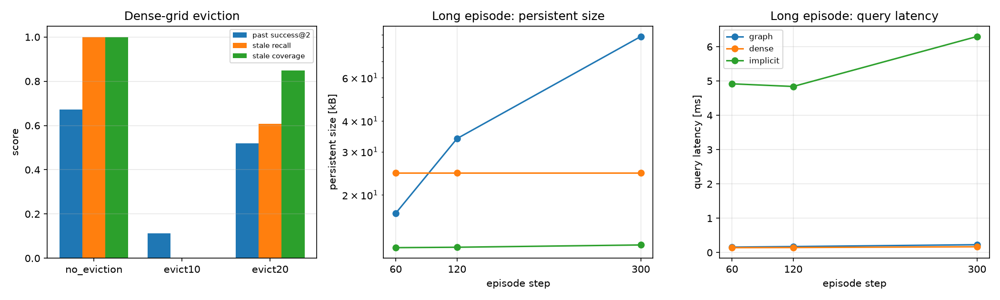

# Extensions: capacity, relational queries, maintenance

## What changed and why

The original benchmark compared one MLP configuration, scored localization and set membership, and ran for 60 steps without maintenance. The review asked for three follow-ups. This document reports them.

`ImplicitMemory` now takes `hidden` in {32, 64, 128} and `depth` in {1, 2}; the default (32, 1) is unchanged. `src/extensions.py` adds the capacity sweep, four relational query types, an evicting dense grid, and a 300-step run. `src/metrics.py` gained optional `query_ms@step` checkpoints and `stale_coverage`; neither changes the original metric files. `tests/test_extensions.py` covers the new configuration, eviction, and query semantics. `pytest -q` passes 31 tests, including the original 21. The extension run takes 309 s on CPU and writes only under `results/extensions/`. The original result files were checked byte for byte against a copy made before this work.

## Experiment A: capacity

Six configurations ran at 3 and 30 objects, five seeds, with the original online budget: 50 SGD steps per update, learning rate 0.01, batch 32, 200-entry replay buffer. The reference rows use the original graph and dense grid on the same episodes. Values are means over seeds; standard deviations are in `capacity.csv`.

Table 1. Capacity sweep. `current@2` and `past@2` are success rates, `stale-answer` is the fraction of answered current queries that are wrong, peak is the `tracemalloc` peak, size is persistent bytes.

| config | objects | current@2 | past@2 | stale-answer | update [ms] | peak [MB] | size [B] |
|---|---|---|---|---|---|---|---|
| w32 d1 | 3 | 0.104 | 0.168 | 0.885 | 37.849 | 1.25 | 3893 |
| w32 d1 | 30 | 0.016 | 0.024 | 0.981 | 39.649 | 1.28 | 12197 |
| w32 d2 | 3 | 0.136 | 0.144 | 0.850 | 47.898 | 1.75 | 12341 |
| w32 d2 | 30 | 0.024 | 0.016 | 0.974 | 51.667 | 1.78 | 20645 |
| w64 d1 | 3 | 0.128 | 0.224 | 0.857 | 38.351 | 2.27 | 5685 |
| w64 d1 | 30 | 0.016 | 0.000 | 0.982 | 40.059 | 2.30 | 13989 |
| w64 d2 | 3 | 0.112 | 0.240 | 0.875 | 61.986 | 3.32 | 38965 |
| w64 d2 | 30 | 0.024 | 0.040 | 0.973 | 60.136 | 3.35 | 47269 |
| w128 d1 | 3 | 0.144 | 0.248 | 0.839 | 41.217 | 4.37 | 9269 |
| w128 d1 | 30 | 0.016 | 0.000 | 0.983 | 42.182 | 4.40 | 17573 |
| w128 d2 | 3 | 0.184 | 0.216 | 0.796 | 72.830 | 6.47 | 141365 |
| w128 d2 | 30 | 0.016 | 0.032 | 0.983 | 73.991 | 6.50 | 149669 |
| graph (ref) | 3 | 0.896 | 0.848 | 0.000 | 0.005 | 0.01 | 2109 |
| graph (ref) | 30 | 0.904 | 0.856 | 0.000 | 0.028 | 0.06 | 16848 |
| dense (ref) | 3 | 0.896 | 0.696 | 0.000 | 0.037 | 0.03 | 24576 |
| dense (ref) | 30 | 0.904 | 0.672 | 0.000 | 0.244 | 0.03 | 24576 |

At 3 objects the best current success@2 is 0.184 (w128 d2) against 0.104 for the default, and the best past success@2 is 0.248 (w128 d1) against 0.168. Graph stays at 0.896 and 0.848. At 30 objects every MLP variant is between 0.016 and 0.024 current, and between 0.000 and 0.040 past. The graph is 0.904 and 0.856. Width and depth cost up to 2.0 times the update latency (37.8 to 74.0 ms), 5.2 times the peak memory (1.25 to 6.50 MB), and 36 times the persistent size (3.9 to 141.4 kB). The largest model has 17,409 weights against 225.

The wider model does not reach a usable operating point at 3 objects, and extra capacity makes no difference at 30. The result rules out too few units as the sole explanation and leaves the training budget and the input encoding as the candidates named in `IMPLICIT_MEMORY_NOTES.md`. It does not separate those two.

## Experiment B: relational and semantic queries

`src/extensions.py` adds `left_of`, `right_of`, `near` (Euclidean, 3 cells), and `nearest_of_class`. Queries are drawn from ground truth. Pair queries are balanced between true and false answers so chance is 0.5. For `nearest_of_class`, the query supplies ground-truth class labels for the candidate objects, the memory supplies positions, and the nearest class member is scored against the ground-truth nearest member. This measures spatial retrieval with the semantic channel held fixed. Five seeds, 25 queries per type per seed, all three memories on the same schedule.

Table 2. Relational accuracy, mean +/- sample standard deviation over five seeds. Chance for the class query is the mean of `1 / (members of the queried class)` across queries.

| memory | left_of | right_of | near | nearest_of_class |
|---|---|---|---|---|
| graph | 0.848 +/- 0.104 | 0.872 +/- 0.104 | 0.824 +/- 0.083 | 0.936 +/- 0.036 |
| dense | 0.832 +/- 0.100 | 0.856 +/- 0.108 | 0.792 +/- 0.052 | 0.864 +/- 0.078 |
| implicit | 0.432 +/- 0.044 | 0.432 +/- 0.044 | 0.416 +/- 0.061 | 0.200 +/- 0.063 |
| chance | 0.500 | 0.500 | 0.500 | 0.217 |

Graph and dense answer pairwise questions at 0.79 to 0.87 and class selection at 0.94 and 0.86. The implicit memory is at 0.42 to 0.43 for pairwise and 0.20 for class selection, which is below the 0.217 chance rate for that query. The difference between graph and dense is small. Dense loses about two points on `near` and seven on `nearest_of_class`, consistent with overwritten voxels and stale positions. The main gap is between the stored representations and the MLP, not between the two explicit stores.

Localization success does not imply relational success. The implicit memory's 0.04 current success in the long run and its near-chance relational scores come from the same inability to return a usable position. The graph and grid carry enough position accuracy for simple relations, but neither stores class, so the class result depends on the oracle label channel and is not evidence of semantic understanding.

## Experiment C: maintenance and long horizon

The dense grid has a variant that clears voxels whose last write is older than a fixed age. Eviction runs before the update, so the current step is written. Table 3 reports no eviction, age 10 and age 20 over five seeds at 30 objects and 60 steps.

For the long run the original three memories ran for 300 steps, five seeds, with 100 queries per type. Size is measured at steps 60, 120 and 300. Query latency is the mean over queries issued in the last 20 steps ending at each checkpoint; this avoids mixing early and late queries.

Table 3. Maintenance and long horizon. Eviction rows are dense-grid variants; horizon rows are the original three memories. Stale precision is undefined for evict10 because it produced no stale answers, so coverage and recall are shown to make that visible.

| part | configuration | step | past success@2 | stale precision | stale recall | stale coverage | size [B] | query latency [ms] | collisions |
|---|---|---|---|---|---|---|---|---|---|
| eviction | no_eviction | - | 0.672 | 0.993 | 1.000 | 1.000 | 24576 | - | 2.60 |
| eviction | evict10 | - | 0.112 | - | 0.000 | 0.000 | 24576 | - | 1.00 |
| eviction | evict20 | - | 0.520 | 0.989 | 0.607 | 0.848 | 24576 | - | 2.00 |
| horizon | graph | 60 | 0.968 | - | - | - | 16848 | 0.158 | - |
| horizon | graph | 120 | 0.968 | - | - | - | 33920 | 0.174 | - |
| horizon | graph | 300 | 0.968 | - | - | - | 88365 | 0.228 | - |
| horizon | dense | 60 | 0.882 | - | - | - | 24576 | 0.142 | - |
| horizon | dense | 120 | 0.882 | - | - | - | 24576 | 0.146 | - |
| horizon | dense | 300 | 0.882 | - | - | - | 24576 | 0.168 | - |
| horizon | implicit | 60 | 0.028 | - | - | - | 12197 | 4.919 | - |
| horizon | implicit | 120 | 0.028 | - | - | - | 12245 | 4.841 | - |
| horizon | implicit | 300 | 0.028 | - | - | - | 12509 | 6.298 | - |

Figure 1. Left: dense-grid eviction variants scored on past success, stale recall and stale coverage. Middle: persistent size over 300 steps. Right: query latency over the same checkpoints. The size axis is logarithmic.

Eviction does not save persistent memory: the arrays keep their shape at 24,576 B. It changes what the map can answer. Age 10 cuts current success from 0.904 to 0.816, cuts past success from 0.672 to 0.112, and removes every stale answer, so stale precision is undefined for that variant. Collisions fall from 2.60 to 1.00 because cleared voxels cannot be overwritten. Age 20 keeps more history: past success 0.520, stale recall 0.607, coverage 0.848, precision 0.989, current 0.888. The cost of eviction is history, not bytes.

A 10-step eviction horizon coincides with the 10-step past-query lag, so an object not observed exactly at `t - 10` has no surviving record for the past query. Age 20 keeps some of those records but still loses about one in six of the stale answers. A maintenance policy for this benchmark needs a horizon tied to the query lag and an explicit decision about whether stale ids should remain reportable.

On the long run, graph size rises from 16,848 B at step 60 to 88,365 B at step 300, a factor of 5.2. Mean query latency rises from 0.158 to 0.228 ms, a factor of 1.4. Current success@2 stays at 0.976 and past success@2 at 0.968. The dense grid stays at 24,576 B and its latency moves from 0.142 to 0.168 ms. The implicit memory moves from 12,197 to 12,509 B and from 4.92 to 6.30 ms, with current success at 0.040.

Graph growth is visible in persistent size by 120 steps, but 60 steps shows only the first part of it, and even at 300 steps the latency penalty is small in absolute terms. The growth has not yet produced an accuracy failure. A longer run or a larger world is needed before claiming that graph cost breaks the benchmark.

## What the new results change

The original failure case bounded one configuration. The capacity sweep bounds six and finds no setting that works at 30 objects. The main conclusion, that a small coordinate MLP is unusable for identity-rich spatial memory, is stronger. It remains specific to this encoder and training budget.

The report's "retrieval, not spatial reasoning" limitation is now partly tested. Graph and dense support simple relations at 0.79 to 0.94; the MLP does not. The report can state that relational queries separate the explicit stores from the MLP, with the class channel supplied as ground truth.

The report's "no memory has eviction" limitation is addressed for the dense grid. Fixed-age eviction trades past and stale answers for freshness and does not reduce persistent size. This does not contradict a report number, but it changes the maintenance statement from "not compared" to "compared for one policy".

The graph growth concern is supported: 5.2 times the size from 60 to 300 steps. Accuracy is stable and latency grows only 1.4 times, so the cost is real but not yet a failure at this scale.

No result in `REPORT.md` is contradicted, so `REPORT.md` is unchanged. The points above extend its limitations rather than correct it.

## Limitations and what remains untested

- World and scale: one synthetic 16 x 16 x 8 grid, at most 300 steps, with 30 initial objects (28 to 37 live during the 300-step runs). No sensor geometry, no real data, no multi-agent setting.
- Sensitivity: the capacity sweep holds the optimizer and encoder fixed. Learning rate, batch, replay weighting, time encoding, id encoding and per-step bias are not ablated, so capacity is separated from the training budget only in the weak sense that more capacity did not help.
- Relational scope: left and right use only the x axis. There are no compound queries, no distances beyond the 3-cell threshold, no orientation or containment, and no uncertainty. `nearest_of_class` uses oracle class labels, so it does not test semantic labelling.
- Maintenance: only fixed-age dense eviction. No graph pruning, recency weighting, confidence decay, LRU, or policy that reserves a minimum history for past queries.
- Measurement: five seeds, one process, CPU, `tracemalloc` peaks and wall-clock latency. Persistent size is an estimate for all memories and an exact array size only for the dense grid. The 300-step latencies are wall-clock measurements that include numpy call overhead at these array sizes.
- Statistics: the MLP at 30 objects is near the floor of the query set (25 queries per type per seed), so differences of 0.008 are one or two queries. A larger query set would be needed to resolve them.
