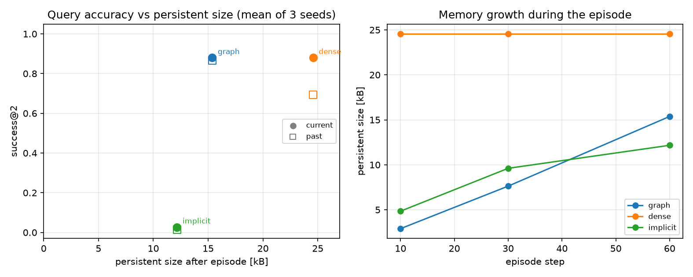

# Three spatial memories under environmental change

## Question

As the environment changes and the mission lengthens, which memory
representation stays correct at an acceptable memory and update cost?

## Method

A 16 x 16 x 8 grid holds 30 objects with ids and continuous positions. Each
step the agent teleports to a random point and observes objects within radius
6 (detection 0.8, Gaussian noise sigma 0.2, occlusion within 0.5 of the sight
line). Objects move (N(0, 0.5) per axis), appear or are removed with
probabilities 0.10, 0.05 and 0.03. An episode is 60 steps.

ObjectGraphMemory keeps a record list per id. DenseGridMemory writes id and
step into a 16 x 16 x 8 voxel array with a parallel last-seen array and never
clears a voxel. ImplicitMemory is a coordinate MLP, not a NeRF, with 32 tanh
units and 225 weights (about 1.8 KB), trained for 50 SGD steps per update on
a 200-entry replay buffer and queried over 2,048 cells at threshold 0.5.

Each seed has 100 ground-truth queries: 25 current, 25 past (10 steps
ago), 25 region change and 25 stale (unobserved for 15 steps). Current and
past succeed within 2 cells; region and stale are scored as sets. An empty
current answer is a failure, while region and stale precision average only
non-empty predictions. Stale-answer rate is the fraction of answered current
queries that are wrong;
peak memory is the `tracemalloc` peak.

## Results

Mean +/- standard deviation over seeds 0, 1, 2, from `results/metrics.csv`.

| metric | ObjectGraph | DenseGrid | Implicit MLP |
|---|---|---|---|
| current success@2 | 0.880 +/- 0.069 | 0.880 +/- 0.069 | 0.027 +/- 0.023 |
| past success@2 | 0.867 +/- 0.101 | 0.693 +/- 0.101 | 0.013 +/- 0.023 |
| region precision | 0.444 +/- 0.144 | 0.228 +/- 0.074 | 0.031 +/- 0.044 |
| region recall | 0.513 +/- 0.175 | 0.460 +/- 0.156 | 0.013 +/- 0.023 |
| stale precision | 1.000 +/- 0.000 | 0.988 +/- 0.020 | 1.000 +/- 0.000 |
| stale recall | 1.000 +/- 0.000 | 1.000 +/- 0.000 | 1.000 +/- 0.000 |
| stale-answer rate | 0.000 +/- 0.000 | 0.000 +/- 0.000 | 0.968 +/- 0.027 |
| persistent size [B] | 15376 +/- 1249 | 24576 +/- 0 | 12168 +/- 24 |
| peak memory [B] | 63341 +/- 12572 | 31175 +/- 3068 | 1361281 +/- 15287 |
| update latency [ms] | 0.016 +/- 0.001 | 0.142 +/- 0.009 | 40.72 +/- 2.35 |
| query latency [ms] | 0.148 +/- 0.016 | 0.134 +/- 0.006 | 4.27 +/- 0.17 |
| size at step 10 [B] | 2896 +/- 232 | 24576 +/- 0 | 4840 +/- 240 |
| size at step 30 [B] | 7627 +/- 839 | 24576 +/- 0 | 9608 +/- 848 |
| size at step 60 [B] | 15376 +/- 1249 | 24576 +/- 0 | 12168 +/- 24 |
| voxel collisions | - | 3.000 +/- 4.359 | - |

Current queries do not separate graph and dense (0.880 against 0.880): both
store every observation with its id and answer immediately after updating.
The split appears in past queries, 0.867 against 0.693. DenseGridMemory
returns the newest voxel at or before `t`, so a later overwrite can erase the
record; the mechanism fits the code but is untested.

The dense grid is flat at 24.6 KB. The graph grows from 2.9 KB at step 10 to
15.4 KB at step 60; the MLP grows from 4.8 KB to 12.2 KB as its replay buffer
fills, with only 1.8 KB of weights. With `alpha = peak memory / persistent
size`, the graph is 4.12, the dense grid 1.27, and the MLP 111.9 [Pangaliman
et al., 2026, arXiv:2604.16482]. The MLP is compact on disk and expensive in
RAM because each query materializes the 2,048-cell scan. For a long-running system alpha sets
the RAM the map consumes. These peaks are lower bounds on resident memory.

Staleness barely separates the three: each implementation records a last-seen
step per id, so graph and MLP score 1.000 precision and recall and the dense
grid 0.988. The metric is bookkeeping, not a discriminator.

## Failure case: the coordinate MLP against 30 objects

| objects | graph success@2 | dense success@2 | implicit success@2 |
|---|---|---|---|
| 3 | 1.000 | 1.000 | 0.067 |
| 5 | 1.000 | 1.000 | 0.200 |
| 10 | 0.933 | 0.933 | 0.133 |
| 20 | 0.933 | 0.933 | 0.033 |
| 30 | 0.867 | 0.867 | 0.033 |

The implicit memory has no usable operating point in this sweep: current
success@2 is 0.067 at 3 objects and 0.033 at 20 and 30, and 0.80 to 0.96 of
its answered current queries were wrong (`results/diagnostics.csv`). It
also fails at three objects, so capacity alone does not explain the result.
These results bound one configuration, not implicit neural representations as
a class: a 32-unit tanh MLP trained for 50 SGD steps per update is unusable
for identity-rich spatial memory, and separating capacity from training budget
requires a capacity-matched or budget-matched ablation at 3 and 30 objects.
Candidate mechanisms are in `IMPLICIT_MEMORY_NOTES.md`.

## Limitations

- The world is synthetic: point observations, dense ids, no sensor geometry.
  The numbers describe these representations, not a deployment.
- Ground truth at query time bounds success and region precision by
  observability; no memory recovers a change it never observed.
- All three follow the specified interface, but none has eviction or decay, so
  maintenance is not compared.
- Three seeds, wide standard deviations. Latency and peak memory are
  single-process CPU measurements that vary between runs;
  persistent size is a per-record estimate, not a serializer measurement.

## Relevance to the Huawei industrial PhD

The benchmark is small and covers the role's four tasks in part. Build:
all three ingest noisy, occluded observations through one interface. Maintain
under change: objects move, appear and disappear each step, and the results
show which representation loses identity and history. Retrieve for reasoning:
queries are localization, set membership and staleness, with no relational
query, so this supports retrieval, not spatial reasoning. Evaluate: seeded
ground-truth queries, per-seed standard deviations, CSV and JSON outputs, and
tests tying the report to results.

No representation wins on this evidence. The graph keeps identity and history
but scans a growing record list and remains smaller than the dense grid at step
60. The dense grid is flat but loses history and ids to overwrites. The 32-unit MLP
is compact, costs about 41 ms per update and stays near chance. The trade-off
points to a hybrid: a dense map for current queries plus an identity and time
store with eviction, to test over hundreds of steps and real sensor geometry.
